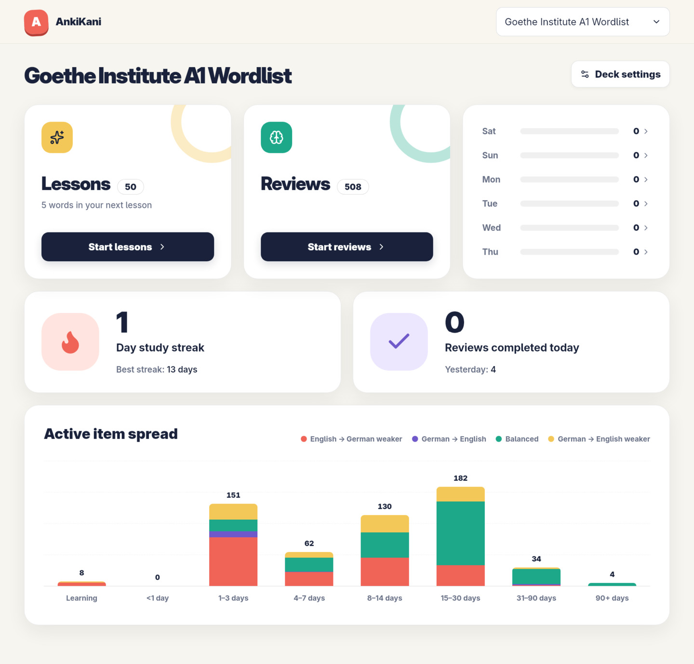
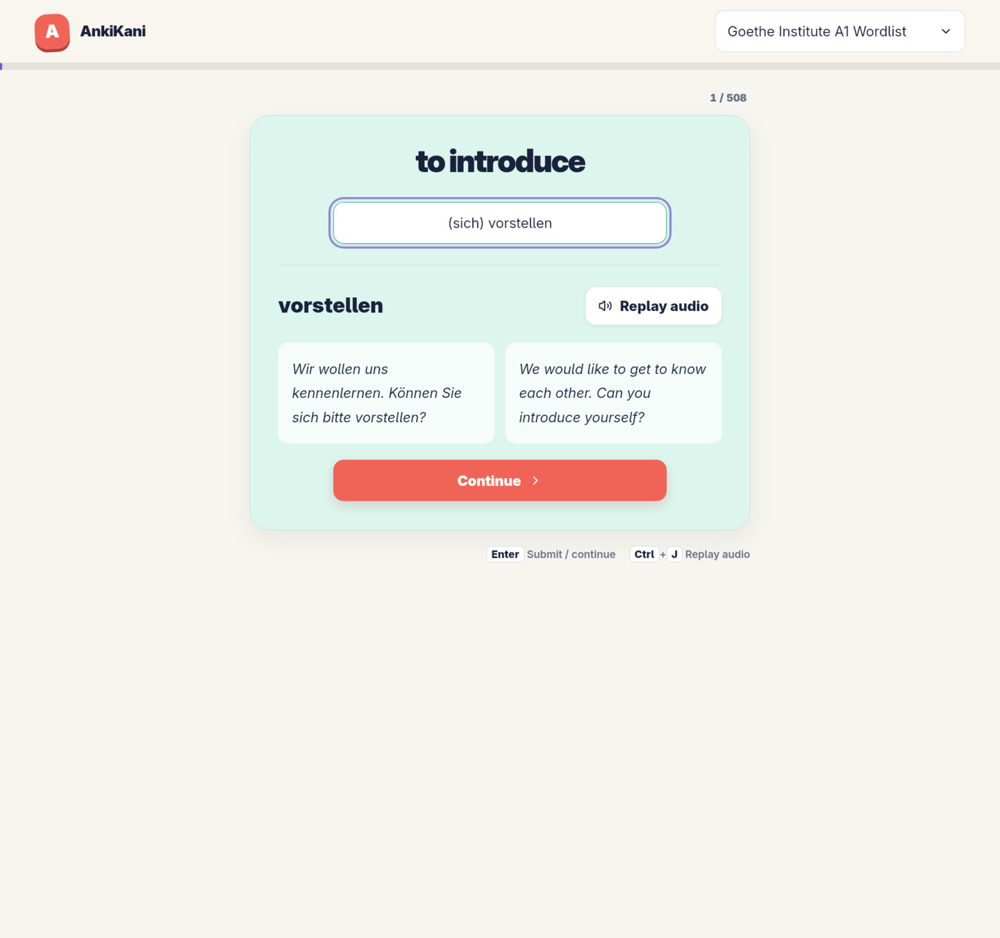

# AnkiKani

Local typed-recall study app for imported Anki vocabulary decks. AnkiKani owns
its collection, review history, media, and FSRS schedule in `data/ankikani.sqlite`.
It keeps the focused `Again`/`Good` flow and does not manage or edit card content.





## Deck support

AnkiKani detects note types inside a deck and its subdecks. It supports plain
Front/Back cards, German vocabulary, cloze sentences, audio prompts, images,
and multi-part answers such as irregular verb forms. Review detected fields in
**Fields** when a deck uses an unfamiliar schema.

## First migration

Migration requires Anki Desktop and AnkiConnect add-on `2055492159`. Import a
`.colpkg` into a temporary Anki profile, start Anki, then run:

Install AnkiConnect from **Tools → Add-ons → Get Add-ons**, restart Anki, then:

```powershell
bun install
bun run migrate
```

The importer writes a staging database, checks note, card, review, and media
counts, then activates it. Repeating migration replaces the local collection
and leaves a timestamped backup in `data/`. AnkiKani does not sync later Anki
changes.

You can also import without Anki Desktop:

```powershell
bun run import -- path/to/deck.apkg
bun run import -- path/to/collection.colpkg
```

The Scheduling screen provides the same importer in the browser.

## Run

Anki Desktop is not required after migration.

```powershell
bun run build
bun start
```

Open the Scheduling screen to change daily limits, learning and relearning
steps, desired retention, maximum interval, sibling burying, and leech threshold.
